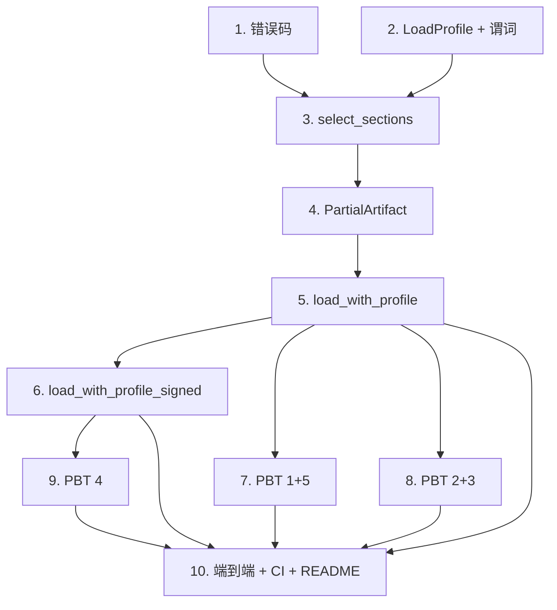

# Implementation Plan

## Overview

本任务清单基于 `requirements.md` 与 `design.md`，把 M6（LoadProfile + profile 驱动的部分加载）的实现拆成 10 个独立可完成的任务。每个任务的产出都直接对应需求文档中的某条验收条款。

任务以 1.x 顺序号编号，便于在 PR 标题里引用，例如 `feat(m6/2): section selection predicate`。

## Tasks

- [x] 1. 错误码
  - 在 `fayger-error` 的 `ErrorCode` 追加 `LdrProfileRequiredSectionMissing`，`as_str` 追加 `LDR_PROFILE_REQUIRED_SECTION_MISSING`。
  - 单元测试：新增码 as_str/Display 一致性；既有码不变。`cargo check --workspace` 通过。
  - _Requirements: 7.1, 7.2, 7.4_

- [x] 2. fayger-loader::select：LoadProfile + 选择谓词
  - 在 `select.rs` 定义 `LoadProfile { target_class, capabilities, max_section_bytes, features }`、`SkipReason`、`SkipRecord`、`SelectionResult`。
  - 实现 `unmet_reasons(section, profile) -> BTreeSet<SkipReason>`（capability/feature/max_size 三类，max_size 同时考虑 section.max_size 与 profile.max_section_bytes）。
  - 单元测试：无约束恒 fits；各约束单独缺失产出对应原因；max_size 两个来源。
  - _Requirements: 1.1, 1.3, 2.1, 2.2, 2.3, 2.4, 9.6_

- [x] 3. fayger-loader::select：select_sections 决策
  - 实现 `select_sections(manifest, profile) -> Result<SelectionResult, FaygerError>`：fits 进 selected；Required 缺失 → `LDR_PROFILE_REQUIRED_SECTION_MISSING`（第一个，manifest 顺序，含 section_id + unmet 列表 + phase=eager）；Optional 不满足 → skipped（reasons 非空）。
  - 单元测试：全选；部分跳过；Required 失败；多个 Required 失败报第一个；空 manifest；确定性。
  - _Requirements: 3.1, 3.2, 3.3, 3.4, 3.5_

- [x] 4. fayger-loader::profile_load：PartialArtifact
  - 在 `profile_load.rs` 定义 `PartialArtifact { manifest, raw_header, raw_trailer, strategy, selection, eager_bodies, lazy }` 与内部 `LazyState`。
  - 实现 `section(&mut self, id)`（未选中→`LDR_PARSE_FAIL` reason=SectionSkipped；Eager 从 map；Lazy fetch）、`is_selected`、`selected_ids`、`skipped`。
  - 单元测试：访问被跳过 id 报 SectionSkipped；选中 id 返回内容。
  - _Requirements: 4.3, 4.4_

- [x] 5. fayger-loader::profile_load：load_with_profile（Eager/Lazy）
  - 实现 `load_with_profile(source, strategy, profile)`：读骨架 → parse_skeleton → verify_manifest_digest（phase=eager）→ select_sections → 按策略加载被选中段（Eager 立即 read+verify、Lazy 保留 plan+selected）。
  - plan 偏移按**全部** manifest section 顺序累加（被跳过段仍占字节）。
  - 在 `lib.rs` `pub use`：`load_with_profile`、`LoadProfile`、`SkipReason`、`SkipRecord`、`SelectionResult`、`PartialArtifact`。
  - 单元测试：Eager 只存被选中段、被跳过段不读；Lazy 选中段首访填充；Required 缺失在读段前失败。
  - _Requirements: 4.1, 4.2, 4.5, 5.1, 6.1, 6.2, 6.3, 6.4_

- [x] 6. fayger-loader::profile_load：load_with_profile_signed
  - 实现 `load_with_profile_signed(source, strategy, profile, truststore)`：在 verify_manifest_digest 之后、select_sections 之前插入 `verify_signature(skeleton, &obj_skeleton, truststore)`（复用 M4，骨架字节足够）。
  - 在 `lib.rs` `pub use`：`load_with_profile_signed`。
  - 单元测试：已签名 BuF 用含公钥 TrustStore 部分加载成功；不含公钥 → UnknownKey。
  - _Requirements: 5.2, 5.3, 6.1_

- [x] 7. PBT：Property 1 + 5（选择决策 / Required 拒绝 Optional 跳过）
  - `tests/selection.rs`：Property 1（selected/skipped 满足谓词与确定性；Required 缺失报错）+ Property 5（Required 失败 / Optional 跳过降级）。
  - 新增生成器：arb_load_profile、给 section 注入约束/Optional 的 manifest 生成器。
  - `ProptestConfig { cases: 500, .. }`；`.regressions` 进 git。
  - _Requirements: 2.x, 3.x, 8.1, 8.4_

- [x] 8. PBT：Property 2 + 3（内容一致 / 被跳过不可访问）
  - `tests/partial_load.rs`：Property 2（被选中段内容与 M5 全选一致）+ Property 3（被跳过 id 访问报 SectionSkipped、Eager 不含、Lazy 不读）。
  - cases ≥ 500；`.regressions` 进 git。
  - _Requirements: 4.2, 4.3, 4.4, 4.5, 8.1_

- [x] 9. PBT：Property 4（部分加载下签名一致性）
  - `tests/partial_signature.rs`：Property 4（同一已签名 BuF 用两个不同 profile 部分加载，签名校验结果相同；篡改被跳过段不改签名、篡改 Section_Index 改签名）。
  - cases ≥ 500；`.regressions` 进 git。
  - _Requirements: 5.2, 5.3, 5.4, 5.5, 8.1_

- [x] 10. 端到端测试、CI 与文档
  - `tests/profile_e2e.rs`：code(Required,无约束)+gpu(Optional,features={gpu})+huge(Optional,max_size=10) → profile A/B 选中/跳过断言；Required 带约束不满足 → 失败；签名两 profile 都通过。
  - 确认 `ci-m0.yml` workspace 级检查自然覆盖（无需新 workflow）。
  - 更新 `release/dev/core/README.md`：新增 M6 profile 说明、PBT 概览与复现步骤；更新里程碑状态。
  - _Requirements: 8.2, 8.3, 8.5_

## Task Dependency Graph

```json
{
  "waves": [
    { "wave": 1, "tasks": [1], "description": "错误码" },
    { "wave": 2, "tasks": [2], "description": "LoadProfile + 选择谓词" },
    { "wave": 3, "tasks": [3], "description": "select_sections 决策（依赖 2 + 1）" },
    { "wave": 4, "tasks": [4], "description": "PartialArtifact（依赖 3）" },
    { "wave": 5, "tasks": [5], "description": "load_with_profile（依赖 4）" },
    { "wave": 6, "tasks": [6], "description": "load_with_profile_signed（依赖 5）" },
    { "wave": 7, "tasks": [7, 8, 9], "description": "全部 PBT（依赖 5/6）" },
    { "wave": 8, "tasks": [10], "description": "端到端、CI、README" }
  ]
}
```

可视化依赖：



## Notes

### 依赖路径要点

- 任务 2（谓词）+ 任务 1（错误码）支撑任务 3（select_sections）。
- 任务 5（load_with_profile）是核心组合点，复用 M5 骨架读取/plan 与 M6 选择。
- 任务 6（signed）在 5 之上插入 M4 签名校验（骨架字节足够）。
- PBT（7/8/9）在 5/6 之后；Property 4 依赖 signed 入口。

### 风险与备选

- **风险 R1：被选中段偏移按子集累加导致读错位置**。
  - 应对：plan 偏移按全部 manifest section 累加；Property 2（内容与全选一致）立即暴露。
- **风险 R2：signed 入口误读 Section 段体**。
  - 应对：verify_signature 只用骨架（Header+Manifest+Section_Index）；Property 4 验证不同子集签名一致，间接保证未依赖段体。
- **风险 R3：Required 缺失在读段后才失败**。
  - 应对：select_sections 在任何 Section 读取之前调用；任务 5 单测断言失败时未发生段读取（用计数 source）。

### 完成标准

M6 完成的判定：

1. 所有 10 个任务的复选框都打勾。
2. `cargo test --workspace --all-features` 在 ubuntu / macos / windows 全部通过（含前序里程碑既有测试不回归）。
3. `cargo clippy --workspace --all-targets --all-features -- -D warnings` 通过。
4. PBT 反例归档目录存在但无未修复反例。
5. `release/dev/core/README.md` 已更新 M6 说明与复现步骤。
6. 在 PR 中合回 `release/dev`，PR 描述列出每个任务的 commit 链接。
