# Design Document

## Overview

本文是 M7 里程碑（资源监测 + 配额 + 故障隔离）的技术设计。M7 在 `fayger-runtime` 的 `Runtime` 与 `InstanceData` 之上新增资源用量监测：从 `manifest.quotas` 读取配额、按调用方注入的用量采样判定超限、超限时把 `Running` 实例自动迁移到 `Suspended`，并保证多实例隔离与单实例故障不扩散。

设计目标按优先级：

1. **正确性优先**：运行时数据区隔离、超限暂停（首次超限维度确定性）、故障隔离，都以可被 PBT 验证的形式表达。
2. **不破坏既有契约**：M7 不改 M0–M6 的对外行为。`Runtime` 的既有方法（load/init/start/.../step/inject_fault）行为不变；M7 新增 `observe_usage` / `quota` / `quota_exceeded` 接口。只新增一个 Runtime 错误码 `RT_QUOTA_EXCEEDED`。
3. **复用 M2 状态机**：超限暂停复用 `Running → Suspended`（M2 已有合法迁移），不引入新生命周期状态。
4. **可测的隔离与计量**：隔离 = "每实例独立 InstanceData + 不共享可变引用"；用量由 `observe_usage` 注入（确定性），真实 OS 计量是后续工作。

## Architecture

### M7 在运行层中的位置

```
Runtime
├── instances: BTreeMap<u64, InstanceData>     # 每实例独立数据区（隔离基础）
│     InstanceData { state, program, pc, last_instruction, failure,
│                    quota: Option<ResourceQuota>,        # M7 新增
│                    last_usage: Option<ResourceUsage>,   # M7 新增
│                    quota_exceeded: Option<QuotaExceeded> } # M7 新增
└── observe_usage(id, usage):                   # M7 新增：注入采样 → 判定 → 超限则 Running→Suspended
```

### 超限暂停数据流

```
observe_usage(id, usage):
    data = instances[id] or RT_INSTANCE_NOT_FOUND
    data.last_usage = Some(usage)                 # 总是记录最近用量
    if let Some(quota) = data.quota:
        if let Some(kind) = first_exceeded(quota, usage):   # Cpu→Memory→Io 顺序
            if data.state == Running:                       # 仅 Running 自动迁移
                data.state = Suspended
                data.quota_exceeded = Some(QuotaExceeded { kind, usage })
            # 非 Running：记录 last_usage，但不迁移、不设置新的 quota_exceeded
        else:
            data.quota_exceeded = None                      # 未超限清空
    return Ok(())
```

> 关键：超限**仅在 Running 状态触发自动迁移**（Req 4.4 / 8.6）。非 Running 时仍记录 last_usage，但不迁移。未超限时清空 quota_exceeded（Req 4.5）。

### Crate 拓扑（M7 扩展 fayger-runtime）

```
release/dev/core/crates/fayger-runtime/src/
├── resource.rs   (M7：ResourceKind / ResourceUsage / QuotaExceeded / first_exceeded)
├── instance.rs   (M7：InstanceData 追加 quota / last_usage / quota_exceeded 字段)
├── runtime.rs    (M7：load 读 quota；新增 observe_usage / quota / quota_exceeded / usage)
└── lib.rs        (pub use)
```

依赖：`fayger-runtime` 已依赖 `fayger-buf`（ResourceQuota 在此）。M7 不引入新依赖。

## Components and Interfaces

### `fayger-error` crate（M7 增量）

```rust
#[non_exhaustive]
pub enum ErrorCode {
    // M0–M6 ...
    /// `RT_QUOTA_EXCEEDED`：实例资源用量超出声明配额（用于超限信息表达）。
    RtQuotaExceeded,
}
```

> M7 的超限主要通过 `quota_exceeded(id)` 查询接口暴露 `QuotaExceeded` 结构；`RT_QUOTA_EXCEEDED` 错误码用于在需要以错误形式表达超限的接口（如可选的 `observe_usage_strict`）或测试断言中标识。M7 的 `observe_usage` 返回 `Ok(())` 并通过状态迁移 + 查询反映超限（非 Running 不迁移），与蓝图"暂停并返回超限信息"一致。

### 模块 `resource`：资源类型与超限判定

```rust
/// 资源类型。顺序固定 Cpu → Memory → Io（用于多维超限时的确定性首选）。
#[derive(Debug, Clone, Copy, PartialEq, Eq, PartialOrd, Ord)]
pub enum ResourceKind { Cpu, Memory, Io }

/// 一次采样的资源用量。三个维度均为实际用量。
#[derive(Debug, Clone, Copy, PartialEq, Eq, Default)]
pub struct ResourceUsage {
    pub cpu_ms_per_sec: u64,
    pub memory_bytes: u64,
    pub io_bytes_per_sec: u64,
}

/// 超限判定结果。
#[derive(Debug, Clone, Copy, PartialEq, Eq)]
pub struct QuotaExceeded {
    pub resource: ResourceKind,
    pub usage: ResourceUsage,
}

/// 返回首个超限维度（Cpu→Memory→Io），无超限返回 None。
pub fn first_exceeded(quota: &ResourceQuota, usage: &ResourceUsage) -> Option<ResourceKind>;
```

`first_exceeded` 实现（对应 Req 3.3 / 4.3，确定性顺序）：

```
if quota.cpu_ms_per_sec = Some(l) && usage.cpu_ms_per_sec > l as u64: return Some(Cpu)
if quota.memory_bytes  = Some(l) && usage.memory_bytes  > l:          return Some(Memory)
if quota.io_bytes_per_sec = Some(l) && usage.io_bytes_per_sec > l:    return Some(Io)
None
```

> 注意 `cpu_ms_per_sec` 配额是 `u32`，与 usage 的 `u64` 比较时把配额提升为 u64。仅对配额声明（`Some`）的维度判定（Req 2.4）。

### 模块 `instance`（M7 增量）

`InstanceData` 追加三个字段：

```rust
pub(crate) struct InstanceData {
    pub(crate) state: LifecycleState,
    pub(crate) program: Vec<UniversalInstruction>,
    pub(crate) pc: usize,
    pub(crate) failure: Option<FailureInfo>,
    pub(crate) last_instruction: Option<UniversalInstruction>,
    // M7 新增：
    pub(crate) quota: Option<ResourceQuota>,
    pub(crate) last_usage: Option<ResourceUsage>,
    pub(crate) quota_exceeded: Option<QuotaExceeded>,
}
```

`InstanceData::new` 改为 `new(program, quota)`，初始化 M7 字段为 None。

### 模块 `runtime`（M7 增量）

`load` 改为从 `obj.manifest.quotas` 读取配额：

```rust
fn load(&mut self, obj: BuFObject) -> Result<InstanceId, FaygerError> {
    let program = derive_program(&obj);
    let quota = obj.manifest.quotas.clone();
    let id = self.next_id; self.next_id += 1;
    self.instances.insert(id, InstanceData::new(program, quota));
    Ok(InstanceId(id))
}
```

新增方法：

```rust
impl<A: Adapter> Runtime<A> {
    /// 注入资源用量采样：记录最近用量；若处于 Running 且超限则迁移到 Suspended 并记录 QuotaExceeded。
    pub fn observe_usage(&mut self, id: InstanceId, usage: ResourceUsage)
        -> Result<(), FaygerError>;   // 未知 id → RT_INSTANCE_NOT_FOUND

    /// 查询该实例当前生效的配额。
    pub fn quota(&self, id: InstanceId) -> Result<Option<&ResourceQuota>, FaygerError>;

    /// 查询该实例最近一次注入的用量。
    pub fn usage(&self, id: InstanceId) -> Result<Option<ResourceUsage>, FaygerError>;

    /// 查询该实例的超限记录（因超限暂停时设置；未超限时为 None）。
    pub fn quota_exceeded(&self, id: InstanceId) -> Result<Option<QuotaExceeded>, FaygerError>;
}
```

`observe_usage` 实现严格按数据流：

```
data = instances.get_mut(id) or RT_INSTANCE_NOT_FOUND
data.last_usage = Some(usage)
match &data.quota {
    None => {}                                   # 无配额：不判定
    Some(q) => match first_exceeded(q, &usage) {
        Some(kind) if data.state == Running => {
            data.state = Suspended
            data.quota_exceeded = Some(QuotaExceeded { resource: kind, usage })
        }
        Some(_) => {}                            # 非 Running：记录 last_usage，不迁移
        None => { data.quota_exceeded = None }   # 未超限：清空
    }
}
Ok(())
```

### 隔离的实现与验证

- **实现**：`instances: BTreeMap<u64, InstanceData>` 中每个 `InstanceData` 是独立的值（owned），`get_mut(id)` 只借出一个实例的可变引用；对一个实例的任何写不触及其它条目。
- **验证**（Property 1）：对实例 A 做任意操作（step / inject_fault / observe_usage / 生命周期迁移），实例 B 的可观测状态（state / pc / last_instruction / failure 存在性 / last_usage / quota_exceeded）保持不变。

## Data Models

### 超限判定决策（图）

```mermaid
flowchart TB
    O[observe_usage&#40;id, usage&#41;] --> Rec[记录 last_usage]
    Rec --> HasQuota{有配额?}
    HasQuota -- 否 --> Done[Ok]
    HasQuota -- 是 --> Ex{first_exceeded?}
    Ex -- None --> Clear[quota_exceeded = None] --> Done
    Ex -- Some&#40;kind&#41; --> Running{state == Running?}
    Running -- 是 --> Susp[state = Suspended; 记录 QuotaExceeded] --> Done
    Running -- 否 --> Done2[不迁移, 仅记录 usage] 
```



### 维度顺序与多维超限

| usage 超过的维度 | first_exceeded 返回 |
| --- | --- |
| 仅 cpu | Cpu |
| 仅 memory | Memory |
| 仅 io | Io |
| cpu + memory | Cpu（顺序首选）|
| memory + io | Memory |
| cpu + memory + io | Cpu |
| 无 | None |

### 故障隔离不变式

对任意两个实例 `i ≠ j`：对 `i` 的 `inject_fault` / `observe_usage`（超限暂停）/ `step` 操作后，`j` 的 `(state, pc, last_instruction, failure.is_some(), last_usage, quota_exceeded)` 与操作前相同。

## Error Handling

### M7 错误/信息映射

| 触发条件 | 表达方式 | 关键字段 |
| --- | --- | --- |
| 未知 InstanceId（observe_usage/quota/usage/quota_exceeded） | `RT_INSTANCE_NOT_FOUND` | instance_id |
| 实例超限（Running） | 状态迁移 Suspended + `quota_exceeded(id)` 返回 `QuotaExceeded` | resource, usage |
| 需要以错误表达超限的场景 | `RT_QUOTA_EXCEEDED`（错误码就绪，M7 主路径用查询接口） | resource, usage |

所有错误 `source_layer = Runtime`，`cause = None`。

### 默认安全姿态

- **仅 Running 自动暂停**：避免在 Suspended / 终态下因用量注入产生意外迁移。
- **未声明维度不超限**：只对配额 `Some` 的维度判定（默认不约束）。
- **未超限清空记录**：避免陈旧的 quota_exceeded 误导调用方。
- **隔离即独立 owned 数据**：不共享可变引用，无 `unsafe`。
- **不 panic**：查找走 Result，比较用 u64 提升避免溢出。

## Correctness Properties

> 从需求 Requirement 7 提取，对应 PBT。沿用前序里程碑的 `.regressions` 归档与配置。

### Property 1: 运行时数据区隔离

*For any* 两个并存实例 `(a, b)` 与对 `a` 的任意操作序列（step / inject_fault / observe_usage / init/start/suspend/resume/terminate）：`b` 的可观测状态（state / pc 通过 step 行为间接 / last_instruction / failure 存在性 / last_usage / quota_exceeded）在操作前后保持不变。

**Validates: Requirements 1.1, 1.2, 1.3, 7.1**

### Property 2: 配额超限触发暂停且维度确定

*For any* 处于 `Running` 的实例、其配额 `q` 与用量序列 `[u0, u1, ...]`：设 `k = min{ i : first_exceeded(q, ui) = Some(_) }`（若存在），则在注入 `uk` 后实例状态为 `Suspended`，且 `quota_exceeded(id).resource == first_exceeded(q, uk)`、`.usage == uk`；在 `uk` 之前实例保持 `Running`。

**Validates: Requirements 3.2, 3.3, 4.1, 4.2, 4.3, 7.1**

### Property 3: 未超限不暂停 / 无配额不触发

*For any* 处于 `Running` 的实例：若其无配额（quota=None），任意用量注入都不改变状态、不设置 quota_exceeded；若有配额但本次用量未超限，状态不变且 quota_exceeded 为 None。

**Validates: Requirements 2.3, 2.4, 4.5, 7.1**

### Property 4: 非 Running 不自动迁移

*For any* 处于 `Initialized` / `Suspended` / `Terminated` / `Failed` 的实例与超限用量注入：状态不发生因超限而起的自动迁移（保持原状态），但 last_usage 被更新。

**Validates: Requirements 4.4, 8.6, 7.1**

### Property 5: 故障隔离

*For any* `N` 个处于 `Running` 的实例，令其中 `ik` 进入 `Failed`（或因超限 `Suspended`）：在不再对 `ij (j≠k)` 注入额外故障/超限的前提下，所有 `ij` 仍保持 `Running`，且对 `ij` 继续 `step` 派发的指令序列与无故障基线一致。

**Validates: Requirements 5.1, 5.2, 5.3, 5.4, 7.1**

## Testing Strategy

### 测试金字塔

```
        ┌────────────────────────────────────────┐
        │ 端到端：两实例不同配额，一超限暂停、       │
        │ 一正常继续，断言互不影响                  │
        └────────────────────────────────────────┘
      ┌──────────────────────────────────────────────┐
      │  PBT (5 properties × ≥500x)                   │
      └──────────────────────────────────────────────┘
   ┌────────────────────────────────────────────────────┐
   │ 单元：first_exceeded 各维度与多维、observe_usage 迁移、 │
   │ load 读 quota、quota/usage/quota_exceeded 查询         │
   └────────────────────────────────────────────────────┘
```

### 单元测试

- `resource`：first_exceeded 单维 / 多维（顺序）/ 无配额维度 / 边界（等于 limit 不超限，> limit 超限）。
- `runtime`：load 从 manifest.quotas 读 quota；observe_usage 在 Running 超限→Suspended、未超限不变、无配额不变；非 Running 超限不迁移；未知 id 报错；usage/quota_exceeded 查询。

### PBT 生成器（fayger-runtime 测试内）

```rust
fn arb_quota() -> impl Strategy<Value = Option<ResourceQuota>>;   // 各维度可选
fn arb_usage() -> impl Strategy<Value = ResourceUsage>;
// 复用既有的 BuFObject 构造（带/不带 quotas）
```

### 端到端测试

`tests/quota_e2e.rs`：加载实例 A（memory_bytes=100）与 B（无配额），均 init+start。对 A 注入 usage{memory=200} → A 暂停且 quota_exceeded.resource=Memory；对 B 注入 usage{memory=999} → B 仍 Running。继续对 B step 派发指令；断言 A 状态不受 B 影响、B 指令序列与基线一致。

### 反例归档 / CI

沿用前序里程碑：每个 PBT 文件 `failure_persistence = WithSource("regressions")`，`.regressions` 进 git。

## Dependency Versions

M7 不引入新的第三方运行时依赖。

## Open Questions

- **Q1**：`observe_usage` 在超限时返回 `Err(RT_QUOTA_EXCEEDED)` 还是 `Ok(())` + 状态迁移 + 查询？
  - 决定：返回 `Ok(())`，超限通过"状态迁移到 Suspended + `quota_exceeded(id)` 查询"反映。理由：超限是一个被监测到的运行事件（导致暂停），而非调用 `observe_usage` 本身的失败；这与蓝图"暂停该实例并返回超限的资源类型与当前用量"一致（信息经查询接口返回）。`RT_QUOTA_EXCEEDED` 错误码就绪，供需要以错误表达的场景使用。
- **Q2**：边界 `usage == limit` 是否超限？
  - 决定：不超限。判定用严格大于 `>`（`usage[d] > limit`）。配额是"允许的上限"，达到上限不算越界。
- **Q3**：非 Running 状态注入超限用量是否记录 quota_exceeded？
  - 决定：不记录 quota_exceeded（仅 Running 超限设置），但更新 last_usage。避免非活跃实例产生误导性的"已超限暂停"记录。
