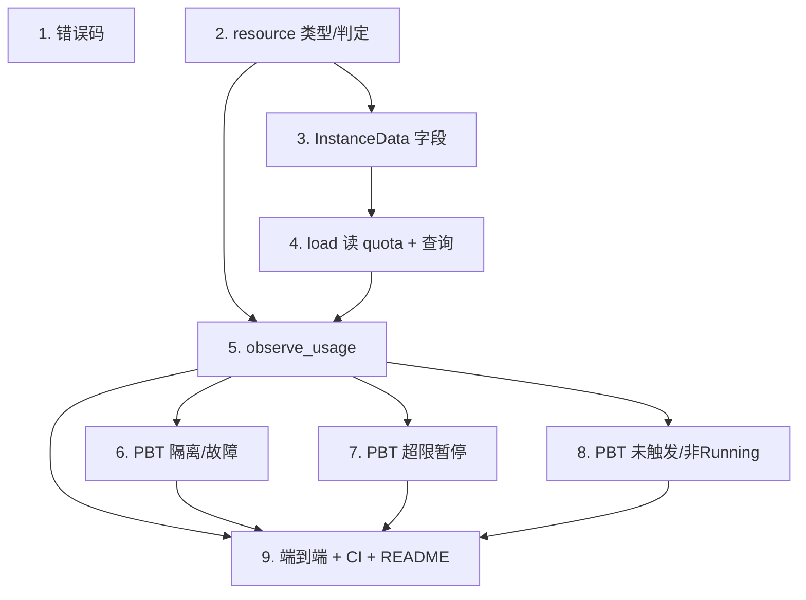

# Implementation Plan

## Overview

本任务清单基于 `requirements.md` 与 `design.md`，把 M7（资源监测 + 配额 + 故障隔离）的实现拆成 9 个独立可完成的任务。每个任务的产出都直接对应需求文档中的某条验收条款。

任务以 1.x 顺序号编号，便于在 PR 标题里引用，例如 `feat(m7/3): observe_usage quota check`。

## Tasks

- [x] 1. 错误码
  - 在 `fayger-error` 的 `ErrorCode` 追加 `RtQuotaExceeded`，`as_str` 追加 `RT_QUOTA_EXCEEDED`。
  - 单元测试：新增码 as_str/Display 一致性；既有码不变。`cargo check --workspace` 通过。
  - _Requirements: 6.1, 6.2, 6.4_

- [x] 2. fayger-runtime::resource：资源类型与超限判定
  - 在 `resource.rs` 定义 `ResourceKind { Cpu, Memory, Io }`、`ResourceUsage { cpu_ms_per_sec, memory_bytes, io_bytes_per_sec }`、`QuotaExceeded { resource, usage }`。
  - 实现 `first_exceeded(quota: &ResourceQuota, usage: &ResourceUsage) -> Option<ResourceKind>`（顺序 Cpu→Memory→Io；严格 `>`；只判定 Some 维度；cpu 配额 u32 提升 u64）。
  - 单元测试：单维超限；多维取首选；边界 `==` 不超限、`>` 超限；未声明维度不超限；无配额。
  - _Requirements: 2.4, 3.3, 4.3_

- [x] 3. fayger-runtime::instance：InstanceData 追加 M7 字段
  - 在 `instance.rs` 给 `InstanceData` 追加 `quota: Option<ResourceQuota>`、`last_usage: Option<ResourceUsage>`、`quota_exceeded: Option<QuotaExceeded>`；`new` 改为 `new(program, quota)`。
  - 单元测试：new 初始化 M7 字段为 None / 给定 quota。
  - _Requirements: 1.1, 2.1_

- [x] 4. fayger-runtime::runtime：load 读取 quota + 查询接口
  - 修改 `Runtime::load` 从 `obj.manifest.quotas` 读取配额传入 `InstanceData::new`。
  - 新增 `quota(id)` / `usage(id)` / `quota_exceeded(id)` 查询（未知 id → `RT_INSTANCE_NOT_FOUND`）。
  - 单元测试：load 后 quota 反映 manifest.quotas（含 None）；查询未知 id 报错。
  - _Requirements: 2.1, 2.2, 2.3_

- [x] 5. fayger-runtime::runtime：observe_usage 超限暂停
  - 实现 `observe_usage(id, usage)`：记录 last_usage；有配额且 Running 且 first_exceeded → Suspended + 记录 QuotaExceeded；非 Running 超限不迁移；未超限清空 quota_exceeded；未知 id → `RT_INSTANCE_NOT_FOUND`。
  - 在 `lib.rs` `pub use`：`ResourceKind`、`ResourceUsage`、`QuotaExceeded`。
  - 单元测试：Running 超限→Suspended + quota_exceeded；未超限不变；无配额不变；非 Running 不迁移但记 last_usage；多维取首选维度。
  - _Requirements: 3.1, 3.2, 3.4, 4.1, 4.2, 4.4, 4.5, 8.6_

- [x] 6. PBT：Property 1 + 5（数据区隔离 / 故障隔离）
  - `tests/isolation.rs`：Property 1（对 A 任意操作不改变 B 的可观测状态）+ Property 5（一个 Failed/Suspended 不影响其它 Running 的状态与 step 指令序列）。
  - `ProptestConfig { cases: 500, .. }`；`.regressions` 进 git。新增生成器 arb_usage、arb_quota、多实例构造。
  - _Requirements: 1.1, 1.2, 1.3, 5.1, 5.2, 5.3, 5.4, 7.1, 7.4_

- [x] 7. PBT：Property 2（超限暂停且维度确定）
  - `tests/quota_suspend.rs`：Property 2（Running 实例与用量序列：首个 first_exceeded 的采样使其 Suspended，quota_exceeded.resource/usage 正确；之前保持 Running）。
  - cases ≥ 500；`.regressions` 进 git。
  - _Requirements: 3.2, 3.3, 4.1, 4.2, 4.3, 7.1_

- [x] 8. PBT：Property 3 + 4（未超限/无配额不触发 / 非 Running 不迁移）
  - `tests/quota_noop.rs`：Property 3（无配额或未超限不暂停、quota_exceeded 为 None）+ Property 4（非 Running 状态超限注入不迁移但更新 last_usage）。
  - cases ≥ 500；`.regressions` 进 git。
  - _Requirements: 2.3, 2.4, 4.4, 4.5, 8.6, 7.1_

- [x] 9. 端到端测试、CI 与文档
  - `tests/quota_e2e.rs`：实例 A(memory=100) + B(无配额) init+start；A 注入 memory=200→暂停(Memory)；B 注入 memory=999→仍 Running；继续 step B，断言 A 不受影响、B 指令序列与基线一致。
  - 确认 `ci-m0.yml` workspace 级检查自然覆盖（无需新 workflow）。
  - 更新 `release/dev/core/README.md`：新增 M7 资源监测说明、PBT 概览与复现步骤；更新里程碑状态。
  - _Requirements: 7.2, 7.3, 7.5_

## Task Dependency Graph

```json
{
  "waves": [
    { "wave": 1, "tasks": [1, 2], "description": "错误码 + 资源类型/判定" },
    { "wave": 2, "tasks": [3], "description": "InstanceData 字段（依赖 2）" },
    { "wave": 3, "tasks": [4], "description": "load 读 quota + 查询（依赖 3）" },
    { "wave": 4, "tasks": [5], "description": "observe_usage（依赖 2/4）" },
    { "wave": 5, "tasks": [6, 7, 8], "description": "全部 PBT（依赖 5）" },
    { "wave": 6, "tasks": [9], "description": "端到端、CI、README" }
  ]
}
```

可视化依赖：



## Notes

### 依赖路径要点

- 任务 2（resource）与任务 1（错误码）可并行；任务 3（InstanceData）依赖 2 的类型。
- 任务 4（load + 查询）依赖 3；任务 5（observe_usage）是核心，依赖 2/4。
- PBT（6/7/8）在 5 之后。

### 风险与备选

- **风险 R1：超限在非 Running 状态误迁移**。
  - 应对：observe_usage 仅在 `state == Running` 时迁移；任务 5/8 显式断言非 Running 不迁移。
- **风险 R2：cpu 配额 u32 与 usage u64 比较溢出/误判**。
  - 应对：配额提升 `u64::from(limit)` 再比较；任务 2 单测覆盖大值。
- **风险 R3：隔离被 BTreeMap 借用规则之外的共享破坏**。
  - 应对：InstanceData 全 owned，无共享可变引用；Property 1 用"对 A 操作不改变 B"验证。

### 完成标准

M7 完成的判定：

1. 所有 9 个任务的复选框都打勾。
2. `cargo test --workspace --all-features` 在 ubuntu / macos / windows 全部通过（含前序里程碑既有测试不回归）。
3. `cargo clippy --workspace --all-targets --all-features -- -D warnings` 通过。
4. PBT 反例归档目录存在但无未修复反例。
5. `release/dev/core/README.md` 已更新 M7 说明与复现步骤。
6. 在 PR 中合回 `release/dev`，PR 描述列出每个任务的 commit 链接。
