# Design Document

## Overview

本文是 M8 里程碑（可观测性事件总线 + 跨层错误链）的技术设计。M8 落实蓝图第 6 章的两条横切关注点：

1. **EventBus**（§6.5–§6.8）：新增 `fayger-observability` crate，提供同步、确定性、单线程的事件总线，承载五类事件（Lifecycle / Quota / Loader / Adapter / Debug），支持按过滤器订阅、取消订阅与调试开关。时间戳为内部逻辑时钟（单调非减）。
2. **错误因果链**（§6.2–§6.3）：在 `fayger-error` 的 `FaygerError` 上加性新增链遍历能力（`chain` / `layer_chain` / `root_cause` / `depth`）与逐层包装构造器（`wrap`）。
3. **运行层接入**（§6.5 Lifecycle/Quota）：`Runtime` 内置一个 `EventBus`，在生命周期迁移、注入故障、注入用量/超限暂停时发布事件；无订阅者时不改变 M2–M7 既有行为。

设计目标按优先级：

1. **正确性优先**：生命周期事件序列一致性、订阅过滤、调试门控、错误链顺序，都以可被 PBT 验证的形式表达。
2. **不破坏既有契约**：M8 不改 M0–M7 的对外行为与字节布局。`FaygerError` 仅加性新增方法；`Runtime` 仅加性新增字段与事件副作用（默认不改变返回值与状态迁移结果）。
3. **无环依赖**：`fayger-observability` 仅依赖 `fayger-error`，不依赖运行层/适配层/加载层；`fayger-runtime` 加性依赖 `fayger-observability`。
4. **确定性可测**：时间戳=逻辑时钟，投递=同步顺序遍历订阅表；真实时钟、宿主通道、异步投递留待后续。

## Architecture

### M8 在工作区中的位置

```
fayger-error  (M8：FaygerError 加性新增 wrap / chain / layer_chain / root_cause / depth)
     ▲
     │ (依赖)
fayger-observability  (M8 新增 crate：EventBus / FaygerEvent / EventDraft / EventFilter / 五类 payload)
     ▲
     │ (加性依赖)
fayger-runtime  (M8：Runtime 内置 EventBus，迁移/故障/用量发布事件)
```

> 依赖方向严格单向，无环：observability 不知道 runtime 的存在；runtime 知道 observability。

### EventBus 数据流（发布 → 过滤 → 投递）

```
publish(draft):
    if draft.category == Debug && !debug_enabled:
        return            # 调试关闭：丢弃，不递增逻辑时钟（Req 3.2）
    event = FaygerEvent { ..draft, timestamp: clock }
    for sub in subscriptions (按注册顺序):     # 确定性顺序（Req 2.6）
        if sub.filter.matches(&event):
            (sub.handler)(&event)             # 同步投递（Req 1.4）
    clock += 1                                 # 投递后递增（Req 1.2）
    return event
```

> 关键：仅"被实际投递（未被调试开关丢弃）"的发布递增逻辑时钟。被调试门控丢弃的 Debug 事件既不投递也不递增（Req 3.2），保证逻辑时钟只在可见事件上前进。即使某事件未匹配任何订阅，它仍是一次"被投递"的发布（占用一个时间戳），以保证时间戳与发布因果一致。

### 错误链结构（cause 自外向内）

```
top    = wrap(RT_INSTANCE_FAILED, Runtime, "...", mid)     # chain()[0]
mid    = wrap(ADP_HOST_CALL_FAILED, Adapter, "...", low)   # chain()[1]
low    = FaygerError::new(<host>, Host, "...")             # chain()[2] = root_cause()

layer_chain() == [Runtime, Adapter, Host]                  # 由外到内
depth() == 3
```

### Crate 拓扑

```
release/dev/core/crates/
├── fayger-error/src/error.rs        (M8：FaygerError 加性新增 wrap/chain/layer_chain/root_cause/depth)
├── fayger-observability/            (M8 新增 crate)
│   ├── Cargo.toml                   (依赖 fayger-error；dev: proptest)
│   └── src/
│       ├── lib.rs                   (pub use)
│       ├── event.rs                 (EventCategory / EventLevel / EventPayload / PhaseStatus / EventDraft / FaygerEvent)
│       ├── filter.rs                (EventFilter + matches)
│       └── bus.rs                   (EventBus：逻辑时钟 / 订阅表 / publish / subscribe / unsubscribe / set_debug_enabled)
└── fayger-runtime/                  (M8：Runtime 内置 EventBus + 事件发布)
    ├── Cargo.toml                   (新增依赖 fayger-observability)
    └── src/runtime.rs               (transition/inject_fault/observe_usage 追加事件发布)
```

## Components and Interfaces

### `fayger-error` crate（M8 增量，加性）

```rust
impl FaygerError {
    /// 逐层包装：把下层错误置于 cause，不改写下层任何字段。
    pub fn wrap(code: ErrorCode, source_layer: Layer, message: impl Into<String>, cause: Self) -> Self;

    /// 自外向内遍历整条因果链（self 在前）。
    pub fn chain(&self) -> impl Iterator<Item = &FaygerError>;

    /// 沿 chain() 的 source_layer 序列（由外到内）。
    pub fn layer_chain(&self) -> Vec<Layer>;

    /// 链尾元素（最内层根因）。
    pub fn root_cause(&self) -> &FaygerError;

    /// 链长（至少为 1）。
    pub fn depth(&self) -> usize;
}
```

> `wrap` 等价于 `FaygerError::new(code, layer, message).with_cause(cause)`，但语义上明确"包装"意图。既有 `with_cause` / `with_context` 不变。`chain()` 用 `std::iter::successors` 沿 `cause` 走，零分配。

### `fayger-observability` crate（M8 新增）

#### 模块 `event`

```rust
/// 事件类别。
#[derive(Debug, Clone, Copy, PartialEq, Eq, Hash)]
pub enum EventCategory { Lifecycle, Quota, Loader, Adapter, Debug }

/// 事件等级（全序：Debug < Info < Warn < Error）。
#[derive(Debug, Clone, Copy, PartialEq, Eq, PartialOrd, Ord, Hash)]
pub enum EventLevel { Debug, Info, Warn, Error }

/// Loader 阶段状态。
#[derive(Debug, Clone, Copy, PartialEq, Eq)]
pub enum PhaseStatus { Enter, Complete, Fail }

/// 类型化事件负载。
#[derive(Debug, Clone, PartialEq, Eq)]
pub enum EventPayload {
    Lifecycle { from: String, to: String },
    Quota { cpu_ms_per_sec: u64, memory_bytes: u64, io_bytes_per_sec: u64, suspended: bool, exceeded: Option<String> },
    Loader { phase: String, status: PhaseStatus },
    Adapter { detail: String },
    Debug { detail: String },
}

/// 发布前的事件草稿（不含 timestamp）。
#[derive(Debug, Clone, PartialEq, Eq)]
pub struct EventDraft {
    pub category: EventCategory,
    pub level: EventLevel,
    pub instance_id: Option<u64>,
    pub payload: EventPayload,
}

/// 已成形事件（含逻辑时钟时间戳）。
#[derive(Debug, Clone, PartialEq, Eq)]
pub struct FaygerEvent {
    pub category: EventCategory,
    pub level: EventLevel,
    pub timestamp: u64,
    pub instance_id: Option<u64>,
    pub payload: EventPayload,
}
```

> 生命周期状态用 `String`（`format!("{state:?}")`）承载，避免 observability 反向依赖 runtime 的 `LifecycleState` 类型（防环）。便利构造器（如 `EventDraft::lifecycle(from, to, instance_id)`）在 `event.rs` 提供。

#### 模块 `filter`

```rust
#[derive(Debug, Clone, Default)]
pub struct EventFilter {
    pub categories: Option<BTreeSet<EventCategory>>,  // None = 全部
    pub min_level: Option<EventLevel>,                // None = 不限
    pub instance_id: Option<u64>,                     // None = 任意
}

impl EventFilter {
    pub fn matches(&self, event: &FaygerEvent) -> bool;  // 三条件 AND
    // builder：any() / with_categories(..) / with_min_level(..) / for_instance(..)
}
```

`matches` 语义（Req 2.4）：
- `categories`: `None` 通过；`Some(set)` 要求 `set.contains(event.category)`。
- `min_level`: `None` 通过；`Some(l)` 要求 `event.level >= l`。
- `instance_id`: `None` 通过；`Some(id)` 要求 `event.instance_id == Some(id)`。

#### 模块 `bus`

```rust
pub struct SubscriptionId(u64);
type Handler = Box<dyn FnMut(&FaygerEvent)>;

pub struct EventBus {
    clock: u64,
    debug_enabled: bool,
    next_sub_id: u64,
    subscriptions: Vec<(SubscriptionId, EventFilter, Handler)>,  // Vec 保注册顺序
}

impl EventBus {
    pub fn new() -> Self;
    pub fn publish(&mut self, draft: EventDraft) -> Option<FaygerEvent>; // None = 被调试门控丢弃
    pub fn subscribe(&mut self, filter: EventFilter, handler: Handler) -> SubscriptionId;
    pub fn unsubscribe(&mut self, id: SubscriptionId) -> bool;
    pub fn set_debug_enabled(&mut self, enabled: bool);
    pub fn debug_enabled(&self) -> bool;
    pub fn clock(&self) -> u64;  // 便于测试断言
}
```

> `Handler` 为 `FnMut` 以便订阅者把事件累积进自身缓冲（测试中常用 `Rc<RefCell<Vec<FaygerEvent>>>`）。投递顺序按 `subscriptions` 的 `Vec` 顺序（注册顺序，Req 2.6）。`unsubscribe` 用 `retain` 移除（Req 2.5）。

> `Debug` 派生：`EventBus` 含 `Handler`（trait object 不可 `Debug`），故 `EventBus` **手动实现 `Debug`**，只打印 `clock` / `debug_enabled` / 订阅数，不打印 handler。

### `fayger-runtime` crate（M8 增量，加性）

`Runtime` 新增字段 `events: EventBus`：

```rust
pub struct Runtime<A: Adapter> {
    rt_version: SemVer,
    adapter: A,
    instances: BTreeMap<u64, InstanceData>,
    next_id: u64,
    events: EventBus,   // M8 新增
}

impl<A: Adapter> Runtime<A> {
    pub fn events(&self) -> &EventBus;          // 只读
    pub fn events_mut(&mut self) -> &mut EventBus;  // 订阅/开关
}
```

事件发布接入点（均为既有方法尾部追加副作用，不改返回语义）：

- `transition(id, cmd)`：迁移成功后，用迁移前 `prev` 与迁移后 `next` 发布 `Lifecycle` 事件（Req 6.2）。
- `inject_fault(id, msg)`：置 `Failed` 后发布 `prev`→`Failed` 的 `Lifecycle` 事件（Req 6.3）。
- `observe_usage(id, usage)`：记录用量后发布 `Quota` 事件（含用量维度、是否暂停、超限维度）；若发生 `Running`→`Suspended`，先发 `Lifecycle`（迁移）后发 `Quota`，或反之——本设计选择**先 Lifecycle 后 Quota**以保证"状态迁移先于其归因事件"读起来自然；二者顺序固定即可（确定性，Req 6.4）。

> 由于 `transition` 是 `Runtime` 内部统一迁移入口，`RuntimeInterface` 的 init/start/suspend/resume/terminate 都经它，故只需在 `transition` 内发布一次即可覆盖五个迁移方法（Req 6.2）。`Runtime::new` 初始化 `events: EventBus::new()`（默认无订阅者、调试关闭）。

> **无订阅者不变性（Req 6.5）**：`publish` 在无订阅者时只递增逻辑时钟、不调用任何 handler、不触碰 instances；状态迁移与查询结果完全不受影响。逻辑时钟是 EventBus 私有可观测量，不属于 M2–M7 的契约面。

## Data Models

### EventBus publish 决策（图）

```mermaid
flowchart TB
    P[publish&#40;draft&#41;] --> D{category==Debug 且 调试关?}
    D -- 是 --> Drop[丢弃: 不投递/不递增时钟] --> RN[返回 None]
    D -- 否 --> Stamp[event = draft + timestamp:=clock]
    Stamp --> Loop[按注册顺序遍历订阅]
    Loop --> M{filter.matches?}
    M -- 是 --> H[调用 handler&#40;event&#41;]
    M -- 否 --> Skip[跳过]
    H --> Next[下一个订阅]
    Skip --> Next
    Next --> Inc[clock += 1]
    Inc --> RS[返回 Some&#40;event&#41;]
```



### 过滤决策表（matches）

| categories | min_level | instance_id | 通过条件 |
| --- | --- | --- | --- |
| None | None | None | 恒通过 |
| Some(S) | — | — | `S.contains(category)` |
| — | Some(L) | — | `level >= L` |
| — | — | Some(id) | `instance_id == Some(id)` |

> 三条件按 AND 组合；任一不满足即不投递。

### 生命周期事件序列一致性不变式

对任意合法迁移序列 `[(s₀,s₁), …, (s_{n-1}, s_n)]`，运行层发出的 `Lifecycle` 事件序列 `[e₁, …, e_n]` 满足：长度相等；`eᵢ.payload.from == s_{i-1}`、`eᵢ.payload.to == sᵢ`；`e₁.timestamp <= … <= e_n.timestamp`。

### 错误链不变式

对任意由 `n` 个错误逐层 `wrap` 而成的链：`depth() == n`；`chain()` 产出 `n` 个元素且第一个为最外层、最后一个为 `root_cause()`；`layer_chain()` 等于由外到内每层 `source_layer`；`wrap` 不改写被包装错误的 `code` / `source_layer` / `context` / `message`。

## Error Handling

### M8 错误/信息映射

| 触发条件 | 表达方式 | 关键点 |
| --- | --- | --- |
| 错误跨层传播 | `FaygerError::wrap(..)` 把下层置入 cause | 不改写下层 source_layer/code/context |
| 链遍历 | `chain` / `layer_chain` / `root_cause` / `depth` | 由外到内顺序 |
| 事件发布被调试门控 | `publish` 返回 `None` | 不投递、不递增逻辑时钟 |
| 取消未知订阅 | `unsubscribe` 返回 `false` | 不影响其余订阅 |

> M8 不新增错误码（Req 7.2）。EventBus 的 `publish` / `subscribe` 不返回 `Result`（无可失败路径）；`publish` 用 `Option<FaygerEvent>` 表达"是否被投递"。

### 默认安全姿态

- **调试默认关闭**（Req 3.1）：避免海量调试事件；显式 `set_debug_enabled(true)` 才投递 Debug。
- **无订阅者无副作用**（Req 6.5）：发布不触碰实例状态；运行层契约不变。
- **同步确定性投递**：无线程、无 I/O、按注册顺序遍历；可重放。
- **不持久化事件**（Req 9.5）：发布即投递给当时订阅者，未投递不保留。
- **不 panic**：handler 为受信调用方代码；M8 不在 publish 中捕获 handler panic（与同步语义一致），但库自身不 panic。
- **无 unsafe**：沿用工作区 `unsafe_code = "forbid"`。

## Correctness Properties

> 对应 PBT。沿用前序里程碑的 `.regressions` 归档与 `cases: 500` 配置。

### Property 1: 生命周期事件序列一致性

*For any* 合法生命周期迁移序列（由随机命令序列驱动 `Runtime` 产生的成功迁移子序列）：订阅 `Lifecycle` 事件后收集到的事件序列与实际发生的迁移序列等长，逐项 `from`/`to` 对齐，且 `timestamp` 单调非减。

**Validates: Requirements 4.1, 4.2, 4.3, 4.4, 6.2, 6.5**

### Property 2: 订阅过滤正确性

*For any* 随机事件草稿序列与随机 `EventFilter`：某订阅收到的事件恰为"被投递且通过该 filter"的事件子序列；不通过 filter 的事件不被该订阅接收。

**Validates: Requirements 2.2, 2.3, 2.4, 2.6**

### Property 3: 调试开关门控

*For any* 含 `Debug` 与非 `Debug` 的随机草稿序列：调试关闭时无 `Debug` 事件被投递且逻辑时钟仅在非 Debug（被投递）事件上前进；开启后 `Debug` 事件按 filter 正常投递；非 Debug 事件的投递不受开关影响。

**Validates: Requirements 1.2, 3.1, 3.2, 3.3, 3.4**

### Property 4: 错误因果链顺序保持

*For any* 由随机 `(code, layer)` 序列逐层 `wrap` 而成的错误链：`depth()` 等于层数；`layer_chain()` 等于由外到内的 `source_layer` 序列；`root_cause()` 为最内层；且每层被包装错误的 `code`/`source_layer`/`context` 未被改写。

**Validates: Requirements 5.1, 5.2, 5.3, 5.4, 5.5**

### Property 5: 取消订阅与多订阅隔离

*For any* 多个订阅与随机事件序列：`unsubscribe(id)` 后该订阅不再接收任何后续事件，其余订阅接收的事件序列与"从未存在被取消订阅"时一致；未知 id 的 `unsubscribe` 返回 `false` 且不影响任何订阅。

**Validates: Requirements 2.1, 2.5, 2.6**

## Testing Strategy

### 测试金字塔

```
        ┌────────────────────────────────────────┐
        │ 端到端：真实 Runtime 跑完整生命周期 +     │
        │ 一次超限暂停，订阅断言事件序列一致         │
        └────────────────────────────────────────┘
      ┌──────────────────────────────────────────────┐
      │  PBT (5 properties × ≥500x)                   │
      └──────────────────────────────────────────────┘
   ┌────────────────────────────────────────────────────┐
   │ 单元：filter.matches 决策表、publish 时钟/门控、       │
   │ subscribe/unsubscribe、FaygerError wrap/chain 系列    │
   └────────────────────────────────────────────────────┘
```

### 单元测试

- `fayger-error`：`wrap` 不改写下层；`chain`/`layer_chain`/`root_cause`/`depth` 在 1 层与多层链上的取值；与既有 `with_cause` 行为一致。
- `fayger-observability::filter`：matches 决策表（各维度 None/Some 组合、等级边界 `>=`、类别集合、实例匹配）。
- `fayger-observability::bus`：publish 分配时钟并递增；Debug 关闭丢弃且不递增；subscribe 顺序投递；unsubscribe 移除；set_debug_enabled 切换。
- `fayger-runtime`：迁移发 Lifecycle、inject_fault 发 Failed、observe_usage 发 Quota（+超限发 Lifecycle）；无订阅者不改变既有断言（复用 M2–M7 既有测试）。

### PBT 生成器

```rust
// fayger-error 测试内：
fn arb_code() -> impl Strategy<Value = ErrorCode>;     // 从既有码集合取样
fn arb_layer() -> impl Strategy<Value = Layer>;
// fayger-observability 测试内：
fn arb_category() / arb_level() / arb_draft() / arb_filter();
// fayger-runtime 测试内（复用 M2/M7 的 object_with）：
fn arb_command_seq();   // 随机生命周期命令序列
```

### 端到端测试

`fayger-runtime/tests/observability_e2e.rs`：构造 `Runtime`，订阅全量事件 → `load`→`init`→`start`→`observe_usage(超限)`→（自动 `Suspended`）→`resume`→`terminate`；断言：收集到的 `Lifecycle` 事件 `from/to` 序列与实际迁移一致、含一条 `Running→Suspended`、且至少一条 `Quota` 事件、时间戳单调非减。

### 反例归档 / CI

沿用前序里程碑：每个 PBT 文件 `failure_persistence = WithSource("regressions")`，`.regressions` 进 git。`ci-m0.yml` 的 workspace 级命令自然覆盖新 crate。

## Dependency Versions

M8 不引入新的第三方运行时依赖。`fayger-observability` 依赖工作区内 `fayger-error`；dev-dependency 用既有 `proptest`。`fayger-error` 新增 `proptest` 为 dev-dependency（承载错误链 PBT）。

## Open Questions

- **Q1**：超限暂停时 Lifecycle 与 Quota 事件的先后？
  - 决定：先发 `Lifecycle`（`Running`→`Suspended`），后发 `Quota`（`suspended=true`）。理由：状态迁移是因，归因事件读起来应紧随其后；顺序固定即满足确定性（Req 6.4）。
- **Q2**：未匹配任何订阅的发布是否递增逻辑时钟？
  - 决定：递增。逻辑时钟表达"第几次可见发布"，与是否有人接收无关；只有被调试开关丢弃的 Debug 事件不递增（它从不可见）。这样时间戳与发布因果一致、可重放。
- **Q3**：生命周期状态在事件里用枚举还是字符串？
  - 决定：字符串（`format!("{state:?}")`）。避免 `fayger-observability` 反向依赖 `fayger-runtime` 的 `LifecycleState`（防止依赖环）。运行层负责把状态名写入 payload，订阅方按字符串比较即可满足序列一致性验证。
- **Q4**：`publish` 是否捕获 handler 的 panic？
  - 决定：不捕获。M8 投递为同步、确定性；handler 由受信调用方提供。库自身保证不 panic，但不为外部 handler 兜底（与第一阶段最小实现一致）。
