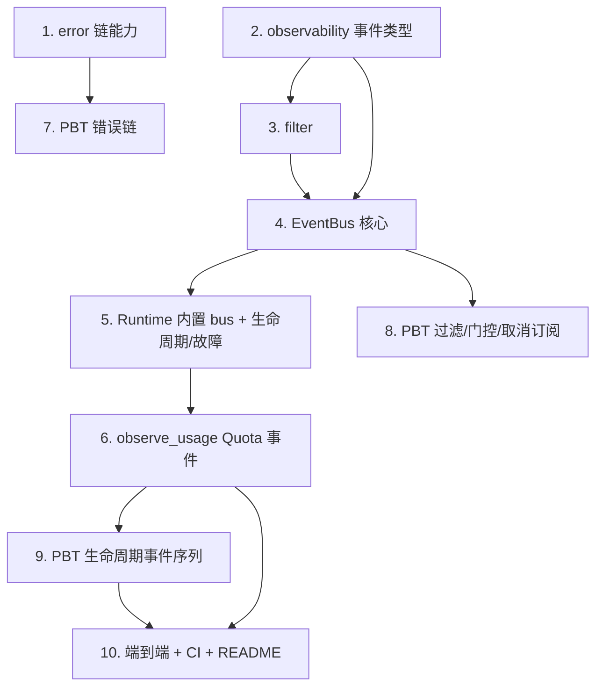

# Implementation Plan

## Overview

本任务清单基于 `requirements.md` 与 `design.md`，把 M8（可观测性事件总线 + 跨层错误链）的实现拆成 10 个独立可完成的任务。每个任务的产出都直接对应需求文档中的某条验收条款。

任务以 1.x 顺序号编号，便于在 PR 标题里引用，例如 `feat(m8/3): event bus publish + clock`。

## Tasks

- [x] 1. fayger-error：错误链能力（加性）
  - 在 `FaygerError` 上新增 `wrap(code, layer, message, cause)`、`chain()`、`layer_chain()`、`root_cause()`、`depth()`；不改既有字段与 `with_cause`/`with_context` 语义。
  - 单元测试：wrap 不改写下层 code/source_layer/context；chain/layer_chain/root_cause/depth 在 1 层与多层链取值；与 with_cause 行为一致。
  - _Requirements: 5.1, 5.2, 5.3, 5.4, 7.1_

- [x] 2. fayger-observability crate 骨架 + 事件类型
  - 新增 crate `fayger-observability`（加入 workspace members；依赖 `fayger-error`，dev: `proptest`）。
  - `event.rs`：`EventCategory`、`EventLevel`（全序）、`PhaseStatus`、`EventPayload`、`EventDraft`、`FaygerEvent` 及便利构造器（lifecycle/quota/loader/adapter/debug）。
  - 单元测试：EventLevel 全序（Debug<Info<Warn<Error）；便利构造器字段正确。
  - _Requirements: 1.1, 9.4_

- [x] 3. fayger-observability::filter：过滤器
  - `filter.rs`：`EventFilter { categories, min_level, instance_id }` + builder + `matches(&FaygerEvent) -> bool`（三条件 AND）。
  - 单元测试：matches 决策表（各维度 None/Some、等级 `>=` 边界、类别集合、实例匹配/不匹配）。
  - _Requirements: 2.4_

- [x] 4. fayger-observability::bus：事件总线核心
  - `bus.rs`：`EventBus`（逻辑时钟、调试开关、`Vec` 订阅表）、`SubscriptionId`、手动 `Debug` 实现。
  - `publish`（Debug 门控丢弃不递增；否则盖时间戳→按注册顺序投递→递增时钟，返回 `Option<FaygerEvent>`）、`subscribe`、`unsubscribe`、`set_debug_enabled`、`debug_enabled`、`clock`。
  - 在 `lib.rs` `pub use` 全部公共类型。
  - 单元测试：publish 分配时钟并递增；Debug 关闭丢弃且不递增；subscribe 顺序投递；unsubscribe 移除；开关切换。
  - _Requirements: 1.1, 1.2, 1.3, 1.4, 2.1, 2.2, 2.3, 2.5, 2.6, 3.1, 3.2, 3.3, 3.4, 9.5_

- [x] 5. fayger-runtime：内置 EventBus + 生命周期/故障事件接入
  - `Runtime` 新增字段 `events: EventBus`；`new` 初始化；新增 `events()` / `events_mut()`。
  - `transition` 迁移成功后发布 `Lifecycle`（prev→next）；`inject_fault` 发布 `Lifecycle`（prev→Failed）。
  - `fayger-runtime/Cargo.toml` 新增依赖 `fayger-observability`。
  - 单元测试：迁移/故障发出预期 Lifecycle 事件；无订阅者时既有断言不变（M2 测试不回归）。
  - _Requirements: 6.1, 6.2, 6.3, 6.5, 7.3, 7.4_

- [x] 6. fayger-runtime：observe_usage 的 Quota/超限事件接入
  - `observe_usage` 记录用量后发布 `Quota` 事件（用量维度 + suspended + exceeded 维度名）；若发生 `Running`→`Suspended`，先发 `Lifecycle` 再发 `Quota`（顺序固定，确定性）。
  - 单元测试：未超限发 Quota(suspended=false)；超限发 Lifecycle(Running→Suspended)+Quota(suspended=true, exceeded=维度)；非 Running 不发 Lifecycle 但发 Quota。
  - _Requirements: 6.4, 6.5_

- [x] 7. PBT：Property 4（错误因果链顺序保持，fayger-error）
  - `fayger-error/tests/error_chain.rs`：随机 `(code, layer)` 序列逐层 wrap；断言 depth=层数、layer_chain=由外到内序列、root_cause=最内层、被包装层字段未改写。
  - `ProptestConfig { cases: 500, .. }`；`.regressions` 进 git；新增 arb_code/arb_layer 生成器。
  - _Requirements: 5.5, 8.1, 8.4_

- [x] 8. PBT：Property 2 + 3 + 5（过滤 / 调试门控 / 取消订阅，fayger-observability）
  - `fayger-observability/tests/filter_dispatch.rs`：P2（过滤正确性）+ P3（调试门控与时钟前进）+ P5（取消订阅与多订阅隔离）。
  - cases ≥ 500；`.regressions` 进 git；arb_draft/arb_filter/arb_category/arb_level 生成器。
  - _Requirements: 1.2, 2.2, 2.3, 2.4, 2.5, 2.6, 3.1, 3.2, 3.3, 3.4, 8.1_

- [x] 9. PBT：Property 1（生命周期事件序列一致性，fayger-runtime）
  - `fayger-runtime/tests/lifecycle_events.rs`：随机命令序列驱动 Runtime，订阅 Lifecycle 事件；断言事件序列与实际成功迁移序列等长、from/to 对齐、时间戳单调非减。
  - cases ≥ 500；`.regressions` 进 git。
  - _Requirements: 4.1, 4.2, 4.3, 4.4, 6.2, 8.1_

- [x] 10. 端到端测试、CI 与文档
  - `fayger-runtime/tests/observability_e2e.rs`：订阅全量事件，跑 load→init→start→observe_usage(超限)→resume→terminate；断言 Lifecycle from/to 序列与迁移一致、含 Running→Suspended、至少一条 Quota、时间戳单调非减。
  - 确认 `ci-m0.yml` workspace 级检查自然覆盖新 crate（无需新 workflow）。
  - 更新 `release/dev/core/README.md`：新增 `fayger-observability` crate 行、M8 PBT 概览与复现步骤、里程碑状态。
  - _Requirements: 8.2, 8.3, 8.5_

## Task Dependency Graph

```json
{
  "waves": [
    { "wave": 1, "tasks": [1, 2], "description": "错误链能力 + observability 事件类型（并行）" },
    { "wave": 2, "tasks": [3], "description": "filter（依赖 2 的事件类型）" },
    { "wave": 3, "tasks": [4], "description": "EventBus 核心（依赖 2/3）" },
    { "wave": 4, "tasks": [5], "description": "Runtime 内置 EventBus + 生命周期/故障事件（依赖 4）" },
    { "wave": 5, "tasks": [6], "description": "observe_usage Quota 事件（依赖 5）" },
    { "wave": 6, "tasks": [7, 8, 9], "description": "PBT（7 依赖 1；8 依赖 4；9 依赖 6）" },
    { "wave": 7, "tasks": [10], "description": "端到端、CI、README（依赖 6/9）" }
  ]
}
```

可视化依赖：



## Notes

### 依赖路径要点

- 任务 1（error 链）与任务 2（事件类型）可并行；任务 3（filter）依赖 2。
- 任务 4（EventBus）依赖 2/3；任务 5（Runtime 接入）依赖 4；任务 6（Quota 事件）依赖 5。
- PBT：7 依赖 1，8 依赖 4，9 依赖 6。

### 风险与备选

- **风险 R1：依赖环（observability ↔ runtime）**。
  - 应对：observability 仅依赖 fayger-error；生命周期状态用 `String` 承载，不引用 runtime 的 `LifecycleState`。任务 2/5 显式遵守。
- **风险 R2：事件副作用破坏 M2–M7 既有行为**。
  - 应对：publish 在无订阅者时不触碰实例；任务 5/6 保证既有方法返回语义与状态迁移结果不变，复用 M2–M7 既有测试不回归。
- **风险 R3：逻辑时钟语义不一致（Debug 丢弃是否递增）**。
  - 应对：被调试门控丢弃的 Debug 不递增；其余被投递发布递增。任务 4/8 显式断言。
- **风险 R4：EventBus 含 trait object handler 无法派生 Debug**。
  - 应对：手动实现 `Debug`，只打印 clock/debug_enabled/订阅数。任务 4 落实。

### 完成标准

M8 完成的判定：

1. 所有 10 个任务的复选框都打勾。
2. `cargo test --workspace --all-features` 在 ubuntu / macos / windows 全部通过（含前序里程碑既有测试不回归）。
3. `cargo clippy --workspace --all-targets --all-features -- -D warnings` 通过。
4. PBT 反例归档目录存在但无未修复反例。
5. `release/dev/core/README.md` 已更新 M8 说明与复现步骤。
6. 在 PR 中合回 `release/dev`，PR 描述列出每个任务的 commit 链接。
