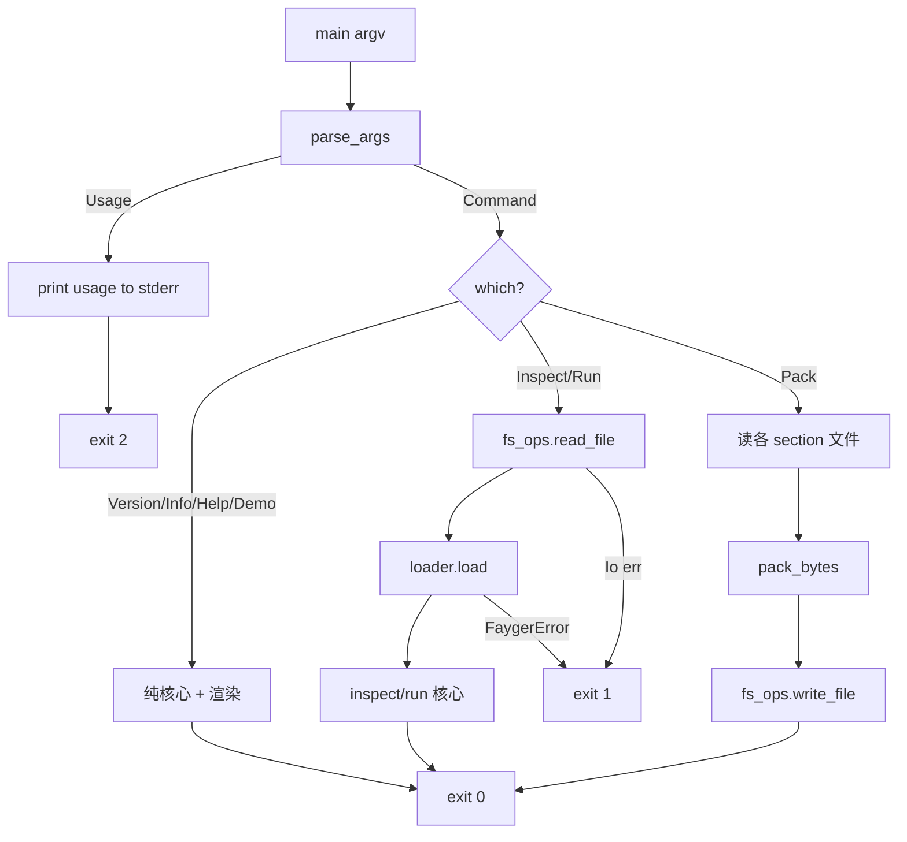

# Design Document

## Overview

本文是 M9 里程碑（CLI 运行基座 + 跨平台分发）的技术设计。M9 把 M0–M8 的库能力封装为一个可安装、可执行的 `fayger` 命令行程序，并提供跨平台分发与安装通道。

设计核心是**纯核心 + 薄壳**：把所有逻辑（参数解析、inspect/run/pack、宿主画像、退出码映射）做成不触达文件系统/网络/时钟的纯函数，放在 `fayger-cli` 的 `lib` 里，由单元测试与 PBT 直接覆盖；`bin/fayger.rs` 只是一个极薄入口：收集 argv → 调用纯核心 → 必要的 FS 读写（薄封装）→ 把 `CliError` 映射成退出码。

设计目标按优先级：

1. **可安装可执行**：产出一个名为 `fayger` 的二进制，提供 version/info/inspect/run/pack/demo/help 子命令，像 Docker/JRE 那样下载即用。
2. **不破坏既有契约**：M9 只新增 `fayger-cli` crate 与分发产物，以加性方式消费 M0–M8 的公共 API，不改任何库 crate 的对外契约。
3. **纯核心、可测、不 panic**：所有失败以 `Result` + `CliError` 表达；FS/进程交互隔离在薄封装层；参数解析与各命令核心为纯函数，PBT 可直接验证全域性与往返。
4. **依赖精简**：参数解析自实现，不引入第三方 CLI 库；不引入新的第三方运行时依赖。

## Architecture

### M9 在工作区中的位置

```
fayger-cli (M9 新增)
├── lib:  纯核心（args / commands / host_profile / report / exit_code）+ FS 薄封装（fs_ops）
└── bin/fayger.rs: 薄入口（argv → run_cli → exit code）
        依赖：fayger-buf / fayger-error / fayger-loader / fayger-runtime
              / fayger-adapter / fayger-observability
```

依赖方向单向向下，不被任何库 crate 反向依赖（无环）。

### 命令执行数据流（以 run 为例）

```
main(argv)
  └─ parse_args(argv) -> Command | CliError::Usage         # 纯
  └─ match Command::Run { path }:
        bytes = fs_ops::read_file(path)?                   # 薄封装（FS）
        obj   = fayger_loader::load(&bytes, &default_policy())?   # 库
        report = run_object(obj)                           # 纯：建 Runtime+订阅+生命周期
        print(report.render())                             # 纯渲染 + 薄 stdout
  └─ exit_code_of(result)                                  # 纯：Ok→0 / Usage→2 / Failure→1
```

### run_object 内部（纯，不触达 FS）

```
run_object(obj) -> RunReport:
    rt = Runtime::new(MockAdapter::new())
    sink = Rc<RefCell<Vec<FaygerEvent>>>            # 订阅事件总线
    rt.events_mut().subscribe(EventFilter::any(), collector(sink))
    id = rt.load(obj)?                              # RuntimeInterface
    rt.init(id)?; rt.start(id)?
    let mut dispatched = 0
    while rt.step(id)? { dispatched += 1 }          # 推进到程序耗尽
    rt.terminate(id)?
    RunReport {
        final_state: rt.state(id)?,                 # Terminated
        dispatched,                                 # == sections 数
        lifecycle_events: count(sink, Lifecycle),
        quota_events: count(sink, Quota),
    }
```

### Crate 拓扑

```
release/dev/core/crates/fayger-cli/
├── Cargo.toml          (lib + [[bin]] name="fayger"；依赖六个库 crate；dev: proptest)
└── src/
    ├── lib.rs          (pub use；run_cli 编排入口)
    ├── args.rs         (Command / parse_args / 用法帮助文本)
    ├── error.rs        (CliError / exit_code_of)
    ├── commands.rs     (inspect_object / run_object / pack_bytes / RunReport / 默认策略)
    ├── host_profile.rs (detect_host_environment / 内置适配器注册 / info 渲染)
    ├── fs_ops.rs       (read_file / write_file 薄封装)
    └── bin/fayger.rs    (main：argv → run_cli → process::exit)

release/dev/core/scripts/
├── build-release.sh    (cargo build --release，打印产物路径)
└── install.sh          (curl|sh：下载/复制 fayger 到 ~/.fayger/bin)

.github/workflows/
└── release.yml         (tag 触发：三平台交叉构建 + SHA-256 校验和上传)

release/dev/core/docs/
└── INSTALL.md          (安装与校验步骤)
```

## Components and Interfaces

### 模块 `error`：CliError 与退出码

```rust
#[derive(Debug)]
pub enum CliError {
    Usage(String),              // 用法错误 → exit 2
    Failure(FaygerError),       // 库层失败 → exit 1
    Io { path: String, detail: String }, // FS 失败 → exit 1
}

#[derive(Debug, Clone, Copy, PartialEq, Eq)]
pub enum ExitCode { Success = 0, Failure = 1, Usage = 2 }

#[must_use]
pub const fn exit_code_of(result: &Result<(), CliError>) -> ExitCode;  // 纯
```

> `From<FaygerError> for CliError`（→ Failure）让库错误用 `?` 自然上浮。`exit_code_of`：`Ok→Success`、`Err(Usage)→Usage`、`Err(Failure|Io)→Failure`。

### 模块 `args`：命令与解析

```rust
#[derive(Debug, Clone, PartialEq, Eq)]
pub enum Command {
    Version,
    Info,
    Inspect { path: String },
    Run { path: String },
    Pack { entry: String, sections: Vec<PackSpec>, out: String },
    Demo,
    Help { topic: Option<String> },
}

#[derive(Debug, Clone, PartialEq, Eq)]
pub struct PackSpec { pub id: String, pub kind: String, pub path: String }

/// 纯解析：argv（不含程序名）→ Command 或用法错误。
pub fn parse_args(args: &[String]) -> Result<Command, CliError>;

/// 顶层 / 子命令帮助文本（纯）。
pub fn usage_text(topic: Option<&str>) -> String;
```

解析规则（确定性、全域）：
- 空 / `help` / `--help` / `-h` → `Command::Help { topic }`（顶层时 `topic=None`）。
- `version` / `--version` / `-V` → `Version`。
- `info` → `Info`。
- `inspect <path>` → `Inspect`；缺 path → `Usage`。
- `run <path>` → `Run`；缺 path → `Usage`。
- `demo` → `Demo`。
- `pack --entry <name> --section <id>:<kind>=<path> [--section ...] -o <out>`：至少一个 section、必须有 `-o`；任一 `--section` 形如 `id:kind=path` 解析失败或 `kind ∉ {code,data,asset}` → `Usage`；缺 `--entry`/`-o` → `Usage`。
- 未知子命令 → `Usage`。

> 解析为纯函数，PBT 直接喂随机 argv 验证「要么 Command 要么 Usage、永不 panic」，且已知子命令恒被识别。

### 模块 `commands`：命令核心（纯）

```rust
/// 默认加载策略：schema [1.0.0, 1.9.9]，runtime 提供 1.0.0，无弃用集。
pub fn default_policy() -> LoadPolicy;

/// 对已加载对象产出可读 Manifest 摘要（纯，不含 FS）。
pub fn inspect_object(obj: &BuFObject) -> String;

#[derive(Debug, Clone, PartialEq, Eq)]
pub struct RunReport {
    pub final_state: LifecycleState,
    pub dispatched: usize,
    pub lifecycle_events: usize,
    pub quota_events: usize,
}
impl RunReport { pub fn render(&self) -> String; }

/// 在运行层参考实现上跑完整生命周期，返回报告（纯，不含 FS）。
pub fn run_object(obj: BuFObject) -> Result<RunReport, CliError>;

/// 由 entry + (id, kind, payload) 列表产出可加载 BuF 字节流（纯，不含 FS）。
pub fn pack_bytes(entry: &str, sections: &[(String, String, Vec<u8>)])
    -> Result<Vec<u8>, CliError>;

/// 构造内存示例 BuF（demo 用，不含 FS）。
pub fn demo_object() -> BuFObject;
```

`pack_bytes` 实现：把每个 `(id, kind, payload)` 映射为 `SectionDescriptor`（kind 字符串→`SectionKind`，长度=payload.len()，可见性 Required，约束默认，digest 占位）与 `Section`；schema/runtime_min 取 `1.0.0`；构造 `BuFObject`（raw_header/trailer 占位）；调用 `fayger_loader::seal(&mut obj)` 后 `fayger_buf::serialize(&obj)`。产出经 `load` 必然成功（seal 保证 digest/crc 有效，schema 1.0.0 在默认策略区间内）。

`run_object` 见上文数据流。`dispatched` 等于 section 数（运行层每段派生一条指令；`step` 在 Running 且未耗尽时返回 true）。

### 模块 `host_profile`：宿主画像与 info（纯 + 平台常量）

```rust
/// 依据 std::env::consts::{OS, ARCH} 确定性构造宿主画像。
pub fn detect_host_environment() -> HostEnvironment;

/// 注册四类内置适配器并按画像选择，渲染 info 文本。
pub fn info_text() -> Result<String, CliError>;
```

`detect_host_environment` 映射（确定性）：
- `OS == "linux"/"macos"/"windows"` → `platform_id = "native-desktop"`，`os_kind = OS`，`sandbox_kind = "none"`，`available_capabilities` = 桌面默认全集（与 NativeDesktopAdapter 支持集对齐，便于演示 granted 非空）。
- 其它 OS → `platform_id = ""`（回退启发式），`os_kind = OS`。

`info_text`：构造 `AdapterRegistry` 注册 NativeDesktop/Server/Browser/InApp → `select(host, HostPolicy::allow_all(画像能力))` → 成功则渲染 `platform_id` 与 `granted()`；无匹配 → `CliError::Failure(ADP_NO_MATCHING_PLATFORM)`。

> `std::env::consts::OS` 是编译期常量，读它不算"触达环境 I/O"，但为可测，`info_text` 内部委托一个接收 `HostEnvironment` 的纯函数 `render_info(host, ...)`，单测对其喂固定画像。

### 模块 `fs_ops`：FS 薄封装

```rust
pub fn read_file(path: &str) -> Result<Vec<u8>, CliError>;   // 映射 io::Error → CliError::Io
pub fn write_file(path: &str, bytes: &[u8]) -> Result<(), CliError>;
```

> 仅这两个函数触达 FS。命令编排在 `run_cli` 中把它们与纯核心拼接。

### `lib.rs`：run_cli 编排

```rust
/// 解析并执行一次 CLI 调用。stdout 文本经 `out` 写出（便于测试注入 buffer）。
pub fn run_cli(args: &[String], out: &mut dyn std::io::Write) -> Result<(), CliError>;
```

`run_cli` 按 Command 分派；version/info/inspect/run/pack/demo/help 各自调用纯核心并把渲染文本写入 `out`。`bin/fayger.rs`：

```rust
fn main() {
    let args: Vec<String> = std::env::args().skip(1).collect();
    let mut stdout = std::io::stdout().lock();
    let result = fayger_cli::run_cli(&args, &mut stdout);
    if let Err(e) = &result { eprintln!("{e}"); }
    std::process::exit(fayger_cli::exit_code_of(&result) as i32);
}
```

### 分发产物

- **`scripts/build-release.sh`**：`cargo build --release -p fayger-cli --bin fayger`，打印 `target/release/fayger` 路径与 `shasum -a 256`。
- **`scripts/install.sh`**：`set -euo pipefail`；确定 `~/.fayger/bin`；从环境变量 `FAYGER_BIN`（本地已构建的二进制）或参数复制 `fayger` 到该目录；`chmod +x`；打印 PATH 配置提示。M9 的安装脚本面向「已构建二进制」与「从源码安装」两条路径，不在脚本内联网下载（下载式安装由 release.yml 产物 + 文档说明承载）。
- **`.github/workflows/release.yml`**：`on: push: tags: ['v*']`；matrix（ubuntu/macos/windows）；构建 `fayger` → 生成 `fayger-<target>` 与 `.sha256` → `actions/upload-artifact` / release 附件。
- **`docs/INSTALL.md`**：脚本安装、`cargo install --path crates/fayger-cli`、校验和验证步骤。

## Data Models

### CLI 调用决策（图）



### 退出码映射表

| 结果 | 退出码 |
| --- | --- |
| `Ok(())` | 0 |
| `Err(CliError::Usage(_))` | 2 |
| `Err(CliError::Failure(_))` | 1 |
| `Err(CliError::Io{..})` | 1 |

### pack 规格语法

```
--section <id>:<kind>=<path>
  id   : 非空，不含 ':' 与 '='
  kind : code | data | asset
  path : 文件路径（pack_bytes 接收的是已读出的 bytes）
```

## Error Handling

### M9 错误映射

| 触发 | 表达 | 退出码 |
| --- | --- | --- |
| 未知命令 / 缺参 / 格式错误 | `CliError::Usage` | 2 |
| 文件不可读 / 不可写 | `CliError::Io` | 1 |
| 加载链失败（结构/摘要/版本/签名） | `CliError::Failure(FaygerError)` | 1 |
| 运行失败（理论上不会，参考实现稳定） | `CliError::Failure` | 1 |
| 无匹配适配器（info） | `CliError::Failure(ADP_NO_MATCHING_PLATFORM)` | 1 |

> M9 不新增错误码（消费既有 `FaygerError`）。`CliError` 是 CLI 层的呈现型错误，不进入任何库 crate 契约。

### 默认安全姿态

- **不 panic**：全路径 `Result`；`main` 唯一的副作用是写 stdout/stderr 与 `process::exit`。
- **不联网**：M9 的 CLI 不发起网络请求；下载式安装由 CI 产物 + 文档承载，安装脚本只复制本地/参数指定的二进制。
- **签名默认不强制**：`inspect`/`run` 用 `load`（M1，签名无关）；签名校验入口（`load_signed`）留待需要时通过后续标志暴露（M9 不引入强制签名标志，遵循蓝图 §6.9 开发期默认关闭）。
- **FS 隔离**：仅 `fs_ops` 触达文件；纯核心可在内存中完整测试。
- **确定性**：解析、渲染、退出码映射、宿主画像构造均确定性。

## Correctness Properties

> 对应 PBT。沿用前序里程碑的 `.regressions` 归档与 `cases: 500` 配置。

### Property 1: 参数解析全域性与稳定识别

*For any* 随机 argv（随机 token 序列）：`parse_args` 要么返回某个 `Command`、要么返回 `CliError::Usage`，永不 panic；且对以已知子命令名开头并带合法参数的 argv，恒识别为对应 Command（如 `["run", p]` → `Run{path:p}`、`["version"]` → `Version`）。

**Validates: Requirements 1.2, 1.4, 1.5, 6.5**

### Property 2: pack → load → run 往返

*For any* 随机 entry 名与随机 `(id, kind, payload)` 列表（id 唯一、kind ∈ {code,data,asset}）：`pack_bytes` 成功产出字节流，`fayger_loader::load` 加载成功，`run_object` 运行成功且 `final_state == Terminated`、`dispatched == sections 数`。

**Validates: Requirements 4.4, 4.5, 5.2, 8.1, 8.2**

### Property 3: inspect 与 Manifest 一致

*For any* 由随机 section 列表 pack 出的 BuFObject：`inspect_object` 文本中呈现的 section 数等于 Manifest section 数，且每个 section id 按原顺序出现在输出中。

**Validates: Requirements 3.5, 5.5**

### Property 4: 退出码映射确定性

*For any* `Result<(), CliError>`：`exit_code_of` 是确定性纯函数，`Ok→0`、`Usage→2`、`Failure/Io→1`；同一输入恒得同一码。

**Validates: Requirements 6.1, 6.2, 6.3, 6.4**

### Property 5: run 事件与生命周期一致

*For any* 由随机 section 列表构造的 BuFObject：`run_object` 报告的 `lifecycle_events` 等于实际发生的生命周期迁移数（init/start/terminate = 3，加上每次 step 不产生迁移），且 `final_state == Terminated`、`dispatched == sections 数`。

**Validates: Requirements 4.1, 4.2, 4.3, 4.4, 4.5**

## Testing Strategy

### 测试金字塔

```
        ┌────────────────────────────────────────┐
        │ 端到端（纯内存）：demo / pack_bytes→load→run │
        └────────────────────────────────────────┘
      ┌──────────────────────────────────────────────┐
      │  PBT (5 properties × ≥500x)                   │
      └──────────────────────────────────────────────┘
   ┌────────────────────────────────────────────────────┐
   │ 单元：parse_args 各分支、usage 文本、inspect_object、   │
   │ run_object、pack_bytes、exit_code_of、render_info     │
   └────────────────────────────────────────────────────┘
```

### 单元测试

- `args`：每个子命令的成功解析；缺参/未知命令/非法 `--section` → Usage；help/version 别名。
- `commands`：`default_policy` 区间；`inspect_object` 含 schema/entry/各 section；`run_object` 在 demo 对象上 Terminated + dispatched；`pack_bytes` 产出经 `load` 成功；空 section 列表的处理。
- `host_profile`：`render_info` 对固定桌面画像产出含 platform_id 与 granted 的文本；无匹配画像 → Failure。
- `error`：`exit_code_of` 三分支。
- `run_cli`：用 `Vec<u8>` 作 out 缓冲，断言 version/demo/help 的输出与退出（成功）。

### PBT 生成器

```rust
fn arb_token() -> impl Strategy<Value = String>;          // 随机 argv token
fn arb_argv() -> impl Strategy<Value = Vec<String>>;
fn arb_kind() -> impl Strategy<Value = String>;           // code|data|asset
fn arb_section() -> impl Strategy<Value = (String,String,Vec<u8>)>;  // 唯一 id 在调用处去重
fn arb_sections() -> impl Strategy<Value = Vec<(String,String,Vec<u8>)>>;
```

### 端到端测试

`fayger-cli/tests/cli_e2e.rs`：
- `run_cli(["demo"], buf)` → Ok，输出含 `Terminated`。
- `run_cli(["version"], buf)` → Ok，输出含版本号。
- pack→load→run 往返（纯内存，经 `pack_bytes` 不落盘）。
- `run_cli(["bogus"], buf)` → Err(Usage)，`exit_code_of` == 2。

### 反例归档 / CI

沿用前序里程碑：每个 PBT 文件 `failure_persistence = WithSource("regressions")`，`.regressions` 进 git。`ci-m0.yml` 的 workspace 级命令自然覆盖新 crate（含 bin target，clippy/test 均跑到）。`release.yml` 是独立工作流，仅 tag 触发，不影响日常 CI。

## Dependency Versions

M9 不引入新的第三方运行时依赖。`fayger-cli` 依赖工作区内六个库 crate；dev-dependency 用既有 `proptest`。

## Open Questions

- **Q1**：参数解析用第三方库（clap）还是自实现？
  - 决定：自实现。子命令集合小且固定，自实现解析可被 PBT 直接验证全域性（任意 argv 不 panic），且不引入新依赖（Req 9.5）。
- **Q2**：`run` 是否经适配层派发到 HostSyscall？
  - 决定：不。M9 的 `run` 走 M2 运行层参考实现（`Runtime` + `MockAdapter`），适配层只在 `info` 用于宿主/适配器查询。运行层与适配层的统一桥接是后续集成里程碑（Req 9.1）。
- **Q3**：安装脚本是否联网下载二进制？
  - 决定：不。M9 的 `install.sh` 只复制本地已构建/参数指定的二进制到 `~/.fayger/bin`；下载式安装由 `release.yml` 产物 + `INSTALL.md` 文档承载（避免脚本内嵌不可测的网络逻辑，Req 9.4）。
- **Q4**：是否支持 `--enforce-signature`？
  - 决定：M9 不引入。遵循蓝图 §6.9「开发期默认关闭」；`inspect`/`run` 用签名无关的 `load`。强制签名标志（走 `load_signed` + TrustStore）留待需要时的后续小增量。
