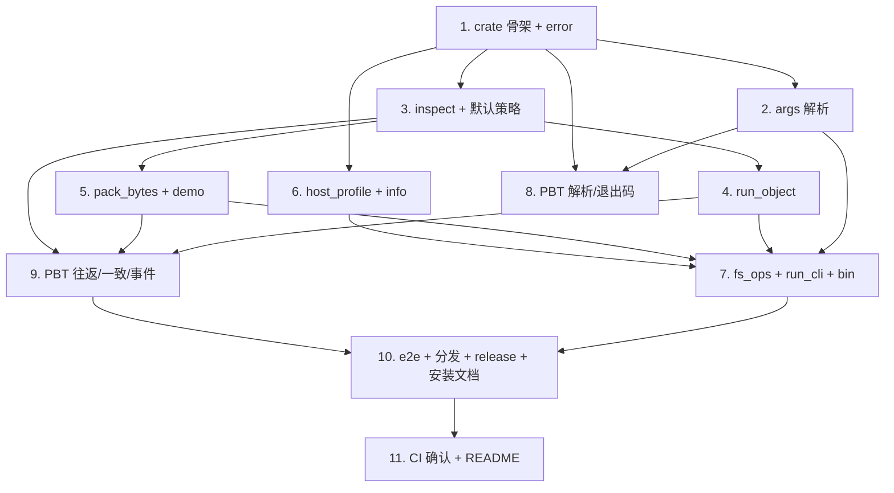

# Implementation Plan

## Overview

本任务清单基于 `requirements.md` 与 `design.md`，把 M9（CLI 运行基座 + 跨平台分发）的实现拆成 11 个独立可完成的任务。每个任务的产出都直接对应需求文档中的某条验收条款。

任务以 1.x 顺序号编号，便于在 PR 标题里引用，例如 `feat(m9/3): args parser`。

## Tasks

- [x] 1. fayger-cli crate 骨架 + 错误与退出码
  - 新增 crate `fayger-cli`（加入 workspace members；依赖六个库 crate；dev: `proptest`；含 `[lib]` 与 `[[bin]] name="fayger"`）。
  - `error.rs`：`CliError { Usage / Failure(FaygerError) / Io }`、`From<FaygerError>`、`ExitCode`、`exit_code_of`（纯）。
  - 单元测试：exit_code_of 三分支（Ok→0 / Usage→2 / Failure|Io→1）。
  - _Requirements: 6.1, 6.2, 6.3, 6.4, 9.3_

- [x] 2. args：Command 与 parse_args
  - `args.rs`：`Command` 枚举、`PackSpec`、`parse_args(&[String]) -> Result<Command, CliError>`、`usage_text`。
  - 解析规则：help/version 别名、inspect/run 取 path、demo、pack（--entry/--section id:kind=path/-o）、未知命令→Usage。
  - 单元测试：各子命令成功解析；缺参/未知/非法 --section → Usage。
  - _Requirements: 1.1, 1.2, 1.3, 1.4, 1.5, 9.5_

- [x] 3. commands：默认策略 + inspect_object
  - `commands.rs`：`default_policy()`（schema [1.0.0,1.9.9]，runtime 1.0.0）；`inspect_object(&BuFObject) -> String`（schema/runtime_min/entry/sections/capabilities/quotas/签名/弃用）。
  - 单元测试：inspect 文本含 schema、entry、各 section id/kind/length。
  - _Requirements: 3.2, 3.5_

- [x] 4. commands：run_object + RunReport
  - `run_object(BuFObject) -> Result<RunReport, CliError>`：Runtime+MockAdapter，订阅事件，init→start→step*→terminate；`RunReport { final_state, dispatched, lifecycle_events, quota_events }` + `render`。
  - 单元测试：demo 对象 run 后 Terminated、dispatched==section 数、lifecycle_events>=3。
  - _Requirements: 4.1, 4.2, 4.3, 4.4, 4.5, 9.1, 9.2_

- [x] 5. commands：pack_bytes + demo_object
  - `pack_bytes(entry, &[(id,kind,payload)]) -> Result<Vec<u8>, CliError>`（kind→SectionKind，构造 BuFObject，seal+serialize）；`demo_object()`（内存示例）。
  - 单元测试：pack_bytes 产出经 `load` 成功；demo_object 经 load+run Terminated；非法 kind → Usage/Failure。
  - _Requirements: 5.1, 5.2, 5.4, 5.5_

- [x] 6. host_profile：宿主画像 + info 渲染
  - `host_profile.rs`：`detect_host_environment()`（按 OS/ARCH 确定性构造）；`render_info(host) -> Result<String, CliError>`（注册四适配器→select→渲染 platform_id+granted）；`info_text()` 包装。
  - 单元测试：固定桌面画像 → 含 native-desktop 与非空 granted；无匹配画像 → Failure(ADP_NO_MATCHING_PLATFORM)。
  - _Requirements: 2.2, 2.3, 2.4, 2.5_

- [x] 7. fs_ops + run_cli 编排 + bin/fayger.rs
  - `fs_ops.rs`：read_file/write_file（io::Error→CliError::Io）。
  - `lib.rs`：`run_cli(&[String], &mut dyn Write) -> Result<(), CliError>`，分派 version/info/inspect/run/pack/demo/help；`pub use` 公共项。
  - `bin/fayger.rs`：main（argv→run_cli→eprintln 错误→process::exit(exit_code)）。
  - 单元测试：run_cli version/demo/help 写出预期文本并 Ok；run_cli 未知命令 → Usage。
  - _Requirements: 1.3, 2.1, 3.1, 3.3, 3.4, 4.6, 6.5_

- [x] 8. PBT：Property 1 + 4（解析全域性 / 退出码映射）
  - `tests/args_props.rs`：P1（随机 argv 不 panic、要么 Command 要么 Usage、已知子命令恒识别）+ P4（exit_code_of 确定性三分支）。
  - `ProptestConfig { cases: 500, .. }`；`.regressions` 进 git；arb_token/arb_argv 生成器。
  - _Requirements: 1.2, 1.4, 1.5, 6.1, 6.2, 6.3, 6.4, 6.5, 8.1_

- [x] 9. PBT：Property 2 + 3 + 5（pack→load→run / inspect 一致 / 事件一致）
  - `tests/roundtrip_props.rs`：P2（pack_bytes→load→run，Terminated + dispatched==section 数）+ P3（inspect section id 序列一致）+ P5（lifecycle_events 与迁移一致）。
  - cases ≥ 500；`.regressions` 进 git；arb_kind/arb_section/arb_sections 生成器（id 去重）。
  - _Requirements: 3.5, 4.1, 4.2, 4.3, 4.4, 4.5, 5.2, 5.5, 8.1, 8.2_

- [x] 10. 端到端测试 + 分发脚本 + Release 工作流 + 安装文档
  - `tests/cli_e2e.rs`：run_cli demo/version/help → Ok 且输出含关键串；bogus → Usage(2)；pack_bytes→load→run 内存往返。
  - `scripts/build-release.sh`（cargo build --release --bin fayger + shasum）、`scripts/install.sh`（复制到 ~/.fayger/bin + PATH 提示）。
  - `.github/workflows/release.yml`（tag 触发三平台构建 + SHA-256 校验和）。
  - `docs/INSTALL.md`（脚本安装 / cargo install / 校验步骤）。
  - _Requirements: 7.1, 7.2, 7.3, 7.4, 7.5, 8.2_

- [x] 11. CI 覆盖确认 + README/文档更新
  - 确认 `ci-m0.yml` workspace 级 fmt/clippy/test/doc 自然覆盖 `fayger-cli`（含 bin target）。
  - 更新 `release/dev/core/README.md`：新增 `fayger-cli` crate 行、CLI 用法概览、M9 PBT 概览与复现步骤、里程碑状态；链接 `docs/INSTALL.md`。
  - _Requirements: 8.3, 8.5_

## Task Dependency Graph

```json
{
  "waves": [
    { "wave": 1, "tasks": [1], "description": "crate 骨架 + 错误/退出码" },
    { "wave": 2, "tasks": [2, 3], "description": "args 解析 + inspect（依赖 1）" },
    { "wave": 3, "tasks": [4, 5, 6], "description": "run / pack / host_profile（依赖 1/3）" },
    { "wave": 4, "tasks": [7], "description": "fs_ops + run_cli + bin（依赖 2-6）" },
    { "wave": 5, "tasks": [8, 9], "description": "PBT（8 依赖 2/1；9 依赖 4/5/3）" },
    { "wave": 6, "tasks": [10], "description": "端到端 + 分发 + release + 安装文档（依赖 7/9）" },
    { "wave": 7, "tasks": [11], "description": "CI 确认 + README（依赖 10）" }
  ]
}
```

可视化依赖：



## Notes

### 依赖路径要点

- 任务 1（骨架+error）是一切的基础；任务 2（args）与 3（inspect）依赖 1。
- 任务 4/5/6（run/pack/host）依赖 3 或 1；任务 7（编排+bin）依赖 2-6。
- PBT：8 依赖 1/2，9 依赖 3/4/5；任务 10 依赖 7/9；任务 11 收尾。

### 风险与备选

- **风险 R1：bin target 触发 clippy 对 main 的额外 lint**。
  - 应对：main 极薄，仅 argv→run_cli→exit；逻辑全在 lib，避免 bin 内 clippy 噪声。
- **风险 R2：纯核心被 FS 污染导致不可测**。
  - 应对：FS 仅在 fs_ops 两个函数；run_cli 把 FS 与纯核心拼接；PBT 只测纯核心。
- **风险 R3：自实现解析遗漏边界（空 argv、重复 flag）导致 panic**。
  - 应对：parse_args 全 Result；Property 1 用随机 argv 验证永不 panic。
- **风险 R4：release.yml 在无 tag 时干扰日常 CI**。
  - 应对：release.yml 仅 `on: push: tags`，与 ci-m0.yml 解耦。

### 完成标准

M9 完成的判定：

1. 所有 11 个任务的复选框都打勾。
2. `cargo test --workspace --all-features` 在 ubuntu / macos / windows 全部通过（含前序里程碑既有测试不回归）。
3. `cargo clippy --workspace --all-targets --all-features -- -D warnings` 通过（含 bin target）。
4. PBT 反例归档目录存在但无未修复反例。
5. `cargo build --release -p fayger-cli --bin fayger` 产出可执行的 `fayger`；`fayger version` / `fayger demo` 可运行。
6. `release/dev/core/README.md` 与 `docs/INSTALL.md` 已更新 M9 说明与安装步骤。
7. 在 PR 中合回 `release/dev`，PR 描述列出每个任务的 commit 链接。
